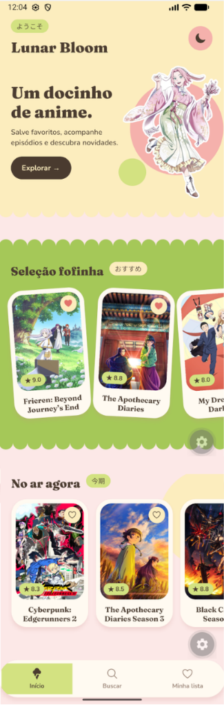
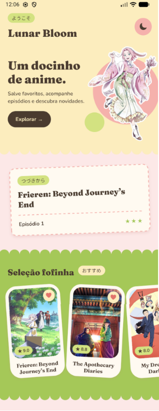
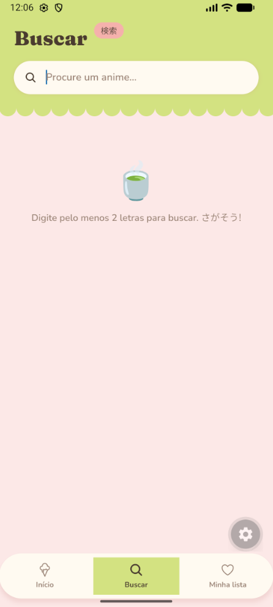
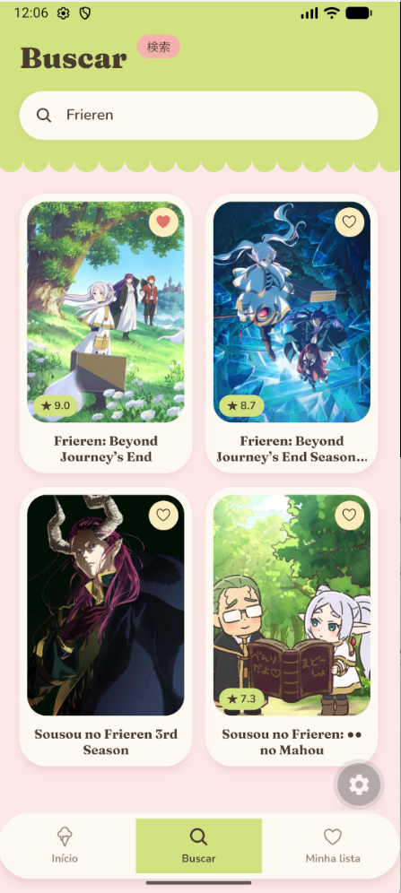
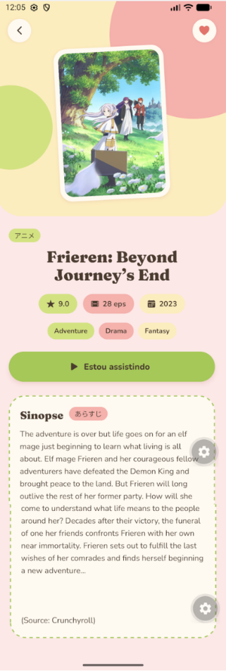
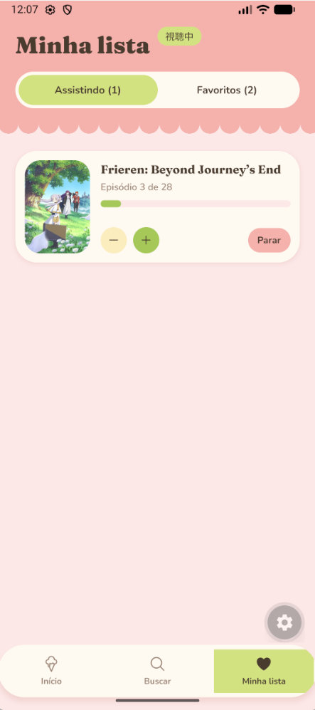
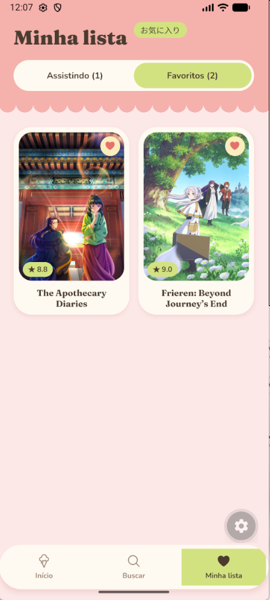

# Lunar Bloom

Aplicativo mobile para quem ama anime: descubra recomendações, guarde seus favoritos para assistir depois e acompanhe em qual episódio você está em cada série.

Projeto da **Atividade Bimestral 2**, feito com **React Native + Expo + TypeScript**, consumindo a API pública **AniList** (GraphQL).

---

## Integrantes

| Nome | 
|------|
|Giovanna Membrive|
|Giuliana Sbrissa|
|Thayssa Fernanda|

---

## Prints do aplicativo


### Início



### Buscar



### Detalhes do anime


### Minha lista: Assistindo


### Minha lista: Favoritos


---

## Funcionalidades

- **Recomendações:** seleção escolhida a dedo de animes leves e queridos (Frieren, Kusuriya no Hitorigoto, My Dress-Up Darling, Kimi ni Todoke e outros) e os animes que estão no ar na temporada atual.
- **Busca:** pesquisa qualquer anime pelo nome, com resultados em grade.
- **Detalhes:** pôster, nota, número de episódios, ano, gêneros e sinopse.
- **Favoritos:** toque no coração (no card ou na tela de detalhes) para guardar um anime para assistir mais tarde.
- **Assistindo:** marque o que você está vendo agora, avance ou volte o episódio atual com os botões **+** e **−** e acompanhe uma barra de progresso.
- **Continuar assistindo:** atalho na tela inicial que leva direto ao último anime marcado como assistindo.
- **Dados salvos no aparelho:** favoritos e progresso continuam ali mesmo depois de fechar o app.
- **Visual fofinho:** paleta matcha e sakura, bordas onduladas, detalhes em japonês e fontes Nunito e Fraunces.

---

## Telas

O app tem **4 telas** (a atividade pede no mínimo 3):

| Tela | Arquivo | O que faz |
|------|---------|-----------|
| Início | `src/screens/HomeScreen.tsx` | Mostra o banner de boas-vindas, o atalho "Continuar assistindo", uma seleção de animes fofos e os animes da temporada. |
| Buscar | `src/screens/SearchScreen.tsx` | Campo de busca que consulta a API depois que a pessoa para de digitar e mostra os resultados em duas colunas. |
| Detalhes | `src/screens/DetailsScreen.tsx` | Informações completas do anime, botão de favoritar e botão "Estou assistindo". |
| Minha lista | `src/screens/MyListScreen.tsx` | Duas abas: **Assistindo** (com controle de episódio) e **Favoritos**. |

A navegação usa **React Navigation**: uma barra de abas na parte de baixo (Início, Buscar, Minha lista) e uma pilha por cima dela para abrir a tela de Detalhes.

---

## API utilizada

**[AniList API](https://docs.anilist.co/)**, uma API pública e gratuita, sem necessidade de chave, baseada em **GraphQL** (uma única URL, `https://graphql.anilist.co`, e a gente escolhe os campos que quer receber).

| Consulta | Para que serve no app |
|----------|----------------------|
| `Page { media(idMal_in: [...]) }` | Carregar de uma vez todos os animes da seleção fofinha. |
| `Media(idMal: ...)` | Tela de detalhes de um anime. |
| `Page { media(search: ...) }` | Busca por nome (com `isAdult: false` para manter só conteúdo adequado). |
| `Page { media(season: ..., seasonYear: ...) }` | Animes que estão sendo exibidos na temporada atual. |

---

## Estrutura do projeto

```
trab2/
├── App.tsx                  # Fontes, navegação (abas + pilha) e provedor de dados
├── index.ts                 # Ponto de entrada do Expo
├── app.json                 # Configurações do Expo
├── docs/prints/             # Prints das telas usados neste README
└── src/
    ├── api.ts               # Chamadas à AniList API (timeout, tentativas, cache e IDs da seleção)
    ├── store.tsx            # Estado global: favoritos e assistindo, salvos no aparelho
    ├── theme.ts             # Cores, raios de borda, sombra e fontes
    ├── types.ts             # Tipos TypeScript (Anime, SavedAnime, rotas)
    ├── components/
    │   └── AnimeCard.tsx    # Card de anime com pôster, nota e coração
    └── screens/
        ├── HomeScreen.tsx
        ├── SearchScreen.tsx
        ├── DetailsScreen.tsx
        └── MyListScreen.tsx
```

---

## Como o programa funciona

### `src/api.ts`: conversando com a API
Todas as consultas à AniList passam pela função `gql`, que envia a consulta GraphQL, **espera no máximo 15 segundos** pela resposta e **tenta de novo até 3 vezes** em caso de lentidão ou erro do servidor. Se tudo falhar, ela devolve uma mensagem clara (sem internet, API lenta ou muitas requisições). Cada resposta também fica em um **cache em memória**, então abrir de novo um anime já carregado é instantâneo.

A AniList e o MyAnimeList usam IDs diferentes. Para facilitar, o app guarda o **ID do MyAnimeList** de cada anime (a AniList também aceita esse ID) e converte a resposta para o formato usado nas telas. A lista `CURATED_IDS` tem os IDs da seleção fofinha. Para recomendar mais um anime, basta acrescentar o ID dele do MyAnimeList nessa lista.

### `src/store.tsx`: favoritos e progresso
Um **Context** do React expõe para o app inteiro:
- `favorites`: lista de animes favoritados;
- `watching`: lista de animes que estão sendo assistidos, cada um com o episódio atual;
- funções para favoritar, marcar como assistindo e alterar o episódio.

Toda vez que uma dessas listas muda, ela é gravada no **AsyncStorage** (armazenamento local do celular). Ao abrir o app, os dados são lidos de volta. Guardamos só o essencial de cada anime (id, título, imagem, nota e total de episódios), o suficiente para mostrar as listas sem depender da internet.

### `src/screens/HomeScreen.tsx`
Ao abrir, o app busca a seleção fofinha (todos os animes em uma única consulta) e os animes da temporada. Se a conexão falhar, aparece um aviso com o motivo e o botão **Tentar de novo**.

### `src/screens/SearchScreen.tsx`
Usa um *debounce* de 600 ms: só consulta a API quando a pessoa para de digitar, evitando uma requisição a cada letra. A tela mostra mensagens claras para os casos de busca curta demais, sem resultados e erro de conexão.

### `src/screens/DetailsScreen.tsx`
Recebe o `id` do anime pela navegação e já mostra o pôster e o título enquanto o restante carrega. Os botões de coração e "Estou assistindo" alternam o estado do anime na lista.

### `src/screens/MyListScreen.tsx`
Alterna entre as abas Assistindo e Favoritos. Na aba Assistindo, cada item tem os botões **+** e **−** para o episódio, uma barra de progresso (quando o total de episódios é conhecido) e o botão **Parar** para remover da lista. O episódio nunca passa do total nem fica abaixo de zero.

---

## Tecnologias

- [React Native](https://reactnative.dev/) + [Expo](https://expo.dev/)
- [TypeScript](https://www.typescriptlang.org/)
- [React Navigation](https://reactnavigation.org/) (abas e pilha)
- [AsyncStorage](https://react-native-async-storage.github.io/async-storage/) (dados salvos no aparelho)
- [@expo/vector-icons](https://docs.expo.dev/guides/icons/) (ícones)
- [@expo-google-fonts/nunito @expo-google-fonts/fraunces](https://github.com/expo/google-fonts) (fonte)

---

## Como rodar

**Pré-requisitos:** Node.js instalado e o app **Expo Go** no celular (ou um emulador Android/iOS).

```bash
# 1. Instalar as dependências do projeto
npm install

# 2. Instalar as bibliotecas usadas pelo app
npx expo install @expo/vector-icons @react-native-async-storage/async-storage expo-font react-native-screens react-native-safe-area-context
npm install @react-navigation/native @react-navigation/native-stack @react-navigation/bottom-tabs @expo-google-fonts/nunito @expo-google-fonts/fraunces

# 3. Iniciar
npx expo start
```

Depois, leia o QR Code com o Expo Go (Android) ou com a câmera (iPhone). Para abrir no navegador, pressione `w` no terminal.

---

## 🐛 Problemas comuns

- **Mensagem "Sem conexão com a internet":** confira o Wi-Fi do celular ou do emulador e toque em **Tentar de novo**.
- **"Muitas requisições":** a API bloqueou por alguns segundos. Aguarde um instante e tente de novo.
- **Tela em branco ao abrir:** confira se todas as bibliotecas da seção "Como rodar" foram instaladas.

---

## 🔮 Ideias para o futuro

- Filtros por gênero e por nota na busca
- Marcar animes como "concluído"
- Modo escuro rosado
- Notificação quando sair um episódio novo
